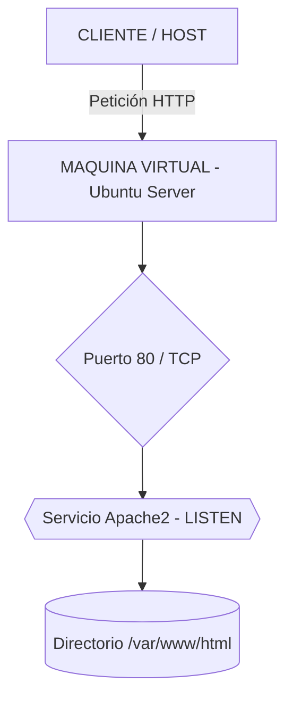
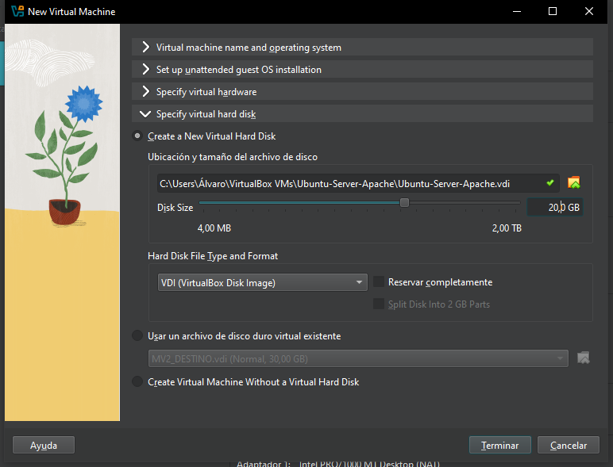
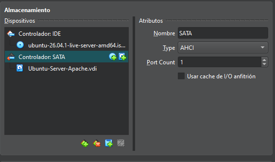
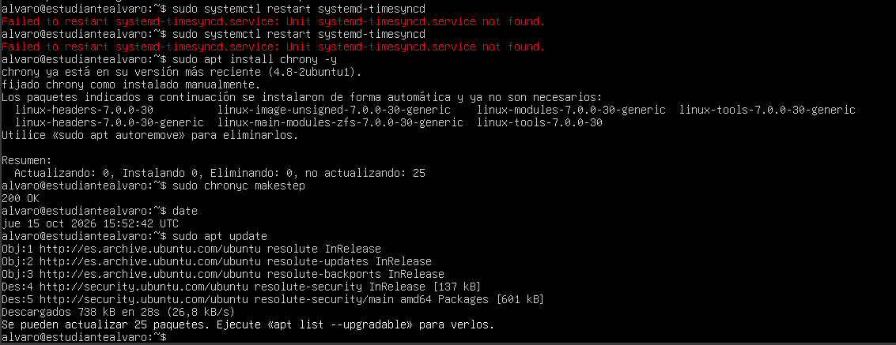
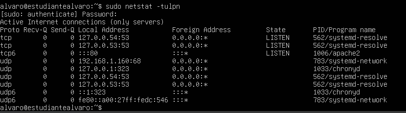

# Práctica: Instalación y Configuración de Apache Web Server en Ubuntu Server

## Paso 1: Arquitectura del Sistema

### Explicación de la Arquitectura
El objetivo de esta actividad es desplegar un servidor web básico utilizando **Apache Web Server** en una máquina virtual con el sistema operativo **Ubuntu Server**. 

El cliente (tu equipo anfitrión o navegador web) realiza peticiones HTTP a través de la red hacia la dirección IP del servidor Ubuntu. La máquina virtual recibe la solicitud en el puerto **80 (TCP)**, donde el proceso `apache2` está en escucha (`LISTEN`), procesa la petición y devuelve la página web por defecto.

### Diagrama de la Arquitectura



---
 ## Paso 2: Preparación e Instalación del Entorno (Máquina Virtual y OS) 1. 
 **Creación de la Máquina Virtual en VirtualBox**: 
 - **Nombre**: `Ubuntu-Server-Apache` 
 - **SO**: Linux / Ubuntu (64-bit) 
 -  **Memoria RAM**: 2048 MB (2 GB) 
 - **Disco Duro**: 20 GB (VDI, Dinámico) 
 - **Red**: Adaptador Puente (Bridged Adapter) para obtener una IP en la red local. 2. **Instalación de Ubuntu Server**: 
	 - Carga de la ISO oficial de Ubuntu Server. 
	 - Configuración de idioma, distribución de teclado (Español) e interfaz de red por DHCP. 
	 - Creación del usuario principal: `alvaro` con hostname `estudiantealvaro`. 
	 - Instalación de OpenSSH Server habilitada. 
---





## Paso 3: Comprobaciones Previas en el Servidor Comandos ejecutados para verificar el entorno de trabajo: 1.

 

**Fecha del servidor** 	 
```
	 - bash date
	 - Thu Oct 15 16:11:21 UTC 2026
```

**Nombre del Host (Hostname)**:

```
	- hostname
	- estudiantealvaro
```

**Usuario actual**:

```
	- whoami
	- alvaro
```

**Dirección IP**:

```
- ip a
- inet 192.168....
```
## Paso 4: Actualización e Instalación de Apache

**Actualizar el índice de paquetes de Ubuntu**:

durante la pracitca he tenido problema para sincornizar la fecha por lo tanto he tenido que descargar el programa Chrony:



```
- sudo apt update
- sudo apt install apache2 -y
```

## Paso 5: Comprobación del Estado del Servicio y Autoarranque

**Verificar el estado de Apache**:

```
- sudo systemctl status apache2
-  apache2.service - The Apache HTTP Server
    Loaded: loaded (/usr/lib/systemd/system/apache2.service; enabled; preset: enabled)
    Active: active (running) since Thu 2026-10-15 16:03:02 UTC
```
>**Significado de `Active: active (running)`**:
> Indica que el servicio de Apache está en ejecución activa en la memoria RAM, sin errores, y > está listo para recibir e interpretar peticiones HTTP entrantes en el puerto correspondiente.

**Verificar que se inicia automáticamente con el sistema**:

```
- sudo systemctl is-enabled apache2
- enabled
```
Paso 6: Gestión del Servicio con *==systemctl==*

Sintaxis utilizada:  ==sudo systemctl + [acción] + [servicio]==

**Detener el servicio Apache**:

```
- sudo systemctl stop apache2
```
Comprobación del estado tras detenerlo:
```
- sudo systemctl status apache2
- Active: inactive (dead) since Thu 2026-10-15 16:11:21 UTC
```
**Iniciar el servicio Apache nuevamente**:

```
- sudo systemctl start apache2
```
**Comprobación del estado:**
```
- sudo systemctl status apache2
- Active: active (running)
```
**Recargar la configuración**:
```
- sudo systemctl reload apache2
```

> **Diferencia entre `start` y `reload`**
> -   **`start`**: Inicia el proceso del servicio desde cero cuando se encuentra completamente detenido >> >(`inactive/dead`). Asigna un nuevo PID (ID de proceso) en el sistema.
>   
>-   **`reload`**: Vuelve a cargar los archivos de configuración en caliente sin detener el proceso en ejecución ni matar el PID principal. Esto evita la interrupción del servicio para los usuarios conectados mientras se aplican cambios de configuración.

## Paso 7: Comprobación de Puertos y Protocolos

**Ejecución del comando para revisar puertos en escucha**:

```
- sudo netstat -tulpn
- Active Internet connections (only servers)
-  Proto Recv-Q Send-Q Local Address       Foreign Address        State PID/Program name
- tcp         0      0 0.0.0.0:80          0.0.0.0:*              LISTEN
```

**Visualizacion imagen puertos:**



**Respuestas a las cuestiones sobre el puerto**:

-   **¿Número de puerto utilizado por Apache?**
    
    El puerto utilizado es el **Puerto 80** (puerto estándar para el protocolo HTTP no cifrado).
    
-   **¿Protocolo utilizado? ¿TCP o UDP?**
    
    Utiliza el protocolo **TCP** (Transmission Control Protocol), garantizando una comunicación fiable y orientada a conexión para la transferencia de datos web.
    
-   **¿Qué significa el estado `LISTEN` para el servidor?**
    
    El estado **`LISTEN`** (Escuchando) indica que el socket del servicio Apache está abierto y en espera activa de conexiones o solicitudes HTTP entrantes enviadas por clientes (navegadores web) hacia ese puerto específico.


