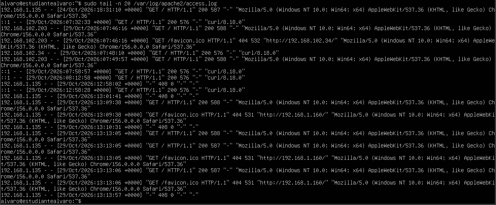
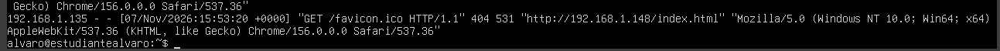
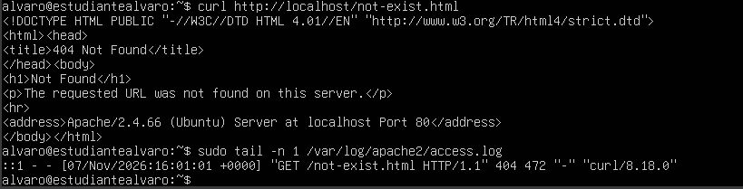

# Práctica 2.2: Análisis de Apache access.log

## Captura 1: Localización y visualización inicial del log
En este paso se localiza el archivo de registro de Apache en la ruta correspondiente y se listan sus entradas iniciales mediante la terminal de Ubuntu Server.

---

## Captura 2: Petición web exitosa desde Windows
Tras acceder correctamente a la página web del servidor desde el navegador del equipo cliente (Windows), se registra la visita en el archivo de logs de Apache.

### Identificación de los campos en la última línea registrada:
* **Dirección IP:** `192.168.1.160` (IP del cliente que realiza la petición).
* **Fecha y Hora:** `[07/Nov/2026:...]` (Momento exacto de la solicitud).
* **Recurso solicitado:** `"GET /index.html HTTP/1.1"` (Archivo y protocolo pedido).
* **Código HTTP:** `200` (Indica que la petición se completó con éxito).
* **Navegador / Cliente:** `Mozilla/5.0 ...` (Identificador del navegador web utilizado).

---

## Captura 3: Simulación de error 404 (Not Found)
Se provoca un error deliberado en el servidor ejecutando una petición a un recurso inexistente mediante el comando `curl` desde la terminal, verificando a continuación que Apache registra correctamente el código de error `404`.

