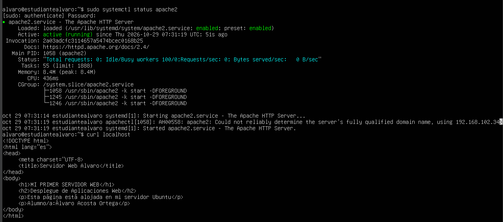
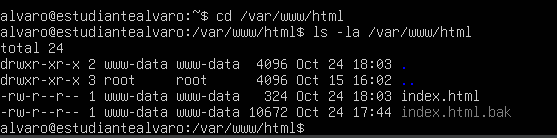
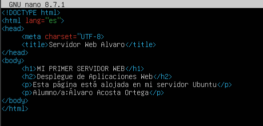

# Práctica: Despliegue de Servidor Web Apache2 en Ubuntu Server

## 1. Introducción y Configuración de Red
Para garantizar que el servidor web sea accesible desde el equipo anfitrión (Windows), se configuró la máquina virtual en **VirtualBox** utilizando un **único adaptador de red en modo Adaptador Puente (Bridged Adapter)** ligado a la tarjeta de red física del equipo.

* **Dirección IP del Servidor:** `192.168.102.34`
* **Puerto del servicio HTTP:** `80`

---

## 2. Instalación y Estado del Servicio Apache2
Se instaló el servidor web Apache2 en la máquina virtual Ubuntu Server y se verificó que el servicio estuviera activo y ejecutándose correctamente mediante el comando:

```bash
sudo systemctl status apache2

```




Nota de Firewall: Se verificó la apertura del puerto 80 en UFW mediante la regla:

```bash
 sudo ufw allow http.
```

Se personalizó la página principal modificando el archivo HTML ubicado en /var/www/html/index.html utilizando el editor de texto nano:

```bash
sudo nano /var/www/html/index.html
```

Se comprobaron los permisos de lectura adecuados para el usuario de Apache (www-data):

```bash
sudo chown -R www-data:www-data /var/www/html
sudo chmod 644 /var/www/html/index.html
```




Para finalizar la práctica, se realizó la prueba de conectividad desde el navegador del sistema anfitrión (Windows) accediendo a la IP del servidor mediante una pestaña de incógnito:

Aunque debido a un problema de conexion entre ubuntu y mi equipo principal el contenido del index.html no carga, ya he probado de diferentes maneras arreglarlo pero no funciona de ninguna manera
